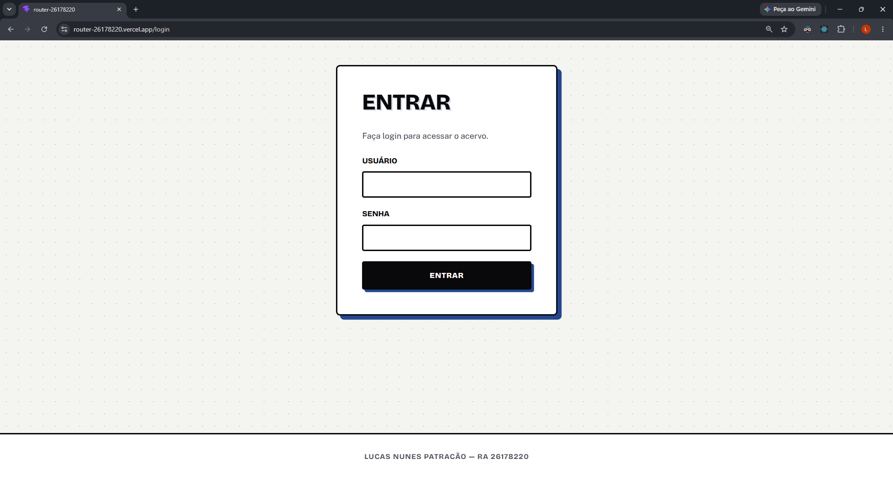
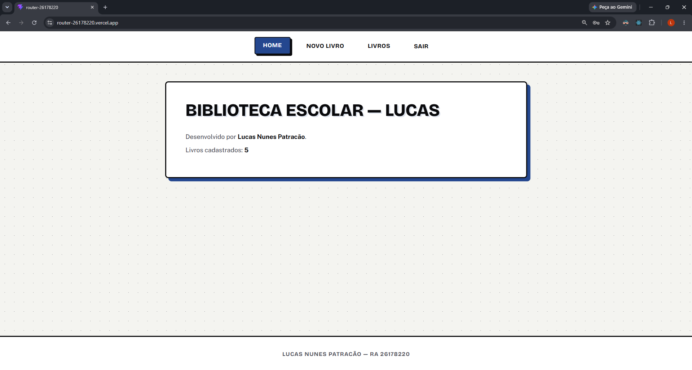
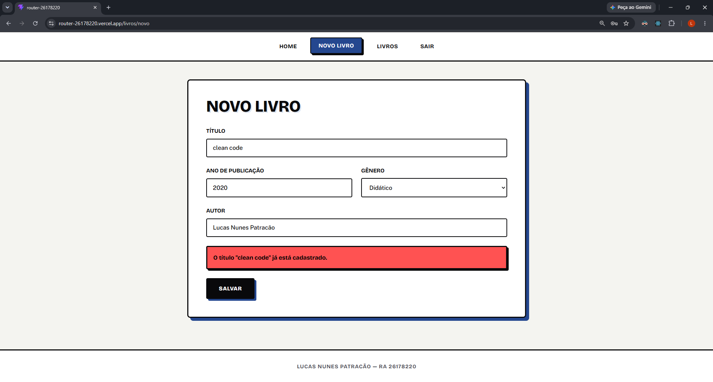
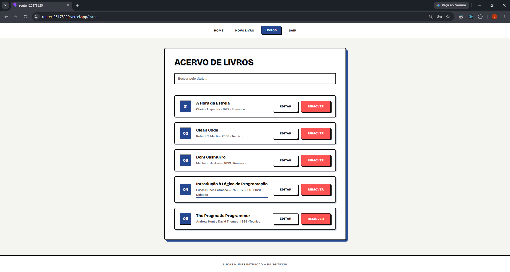
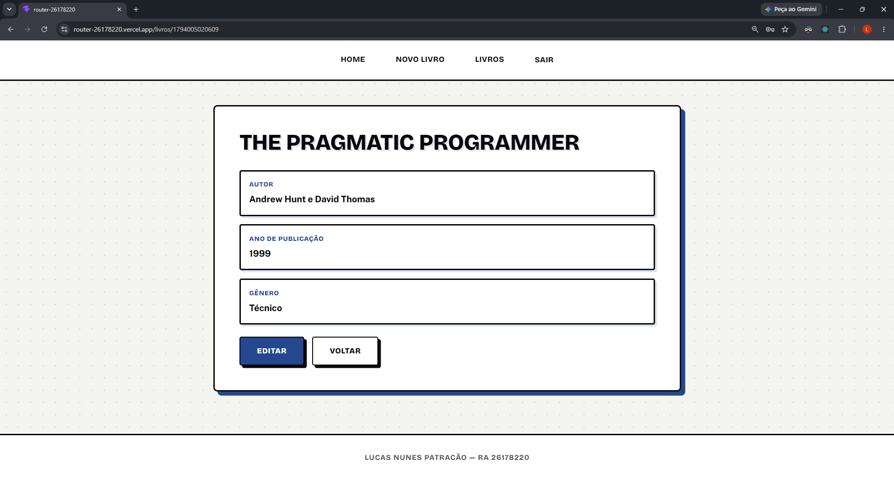
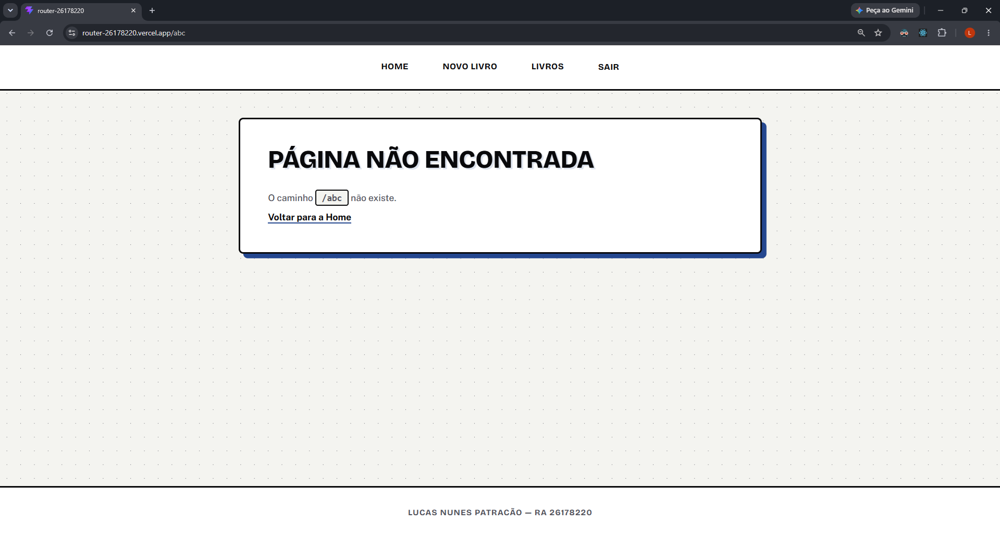

<div align="center">

# 📚 Biblioteca Escolar — Lucas

### Agenda Personalizada com React Router


[](COLE_AQUI_O_LINK_DA_VERCEL)
[](COLE_AQUI_O_LINK_DO_DRIVE)

</div>

---

## 👤 Identificação

| Campo | Informação |
|---|---|
| **Aluno** | Lucas Nunes Patracão |
| **RA** | 26178220 |
| **Curso** | Tecnólogo em Análise e Desenvolvimento de Sistemas |
| **Instituição** | Faculdade de Tecnologia SENAI Antonio Adolpho Lobbe — São Carlos/SP |
| **Unidade Curricular** | Desenvolvimento Front-End |

## 🧮 Meus Parâmetros

Dígitos do RA: `2 6 1 7 8 2 2 0`

| Parâmetro | Cálculo | Resultado |
|---|---|---|
| **A** | Dois últimos = 20; 20 mod 20 = 0 | Biblioteca Escolar (slug `livros`) |
| **B** | Antepenúltimo dígito = 2 | Título Repetido Bloqueado |
| **C** | 2+6+1+7+8+2+2+0 = 28; 28 mod 6 = 4 | Lista em Ordem Alfabética pelo Título |
| **D** | Quarto dígito do final = 8; 8 mod 4 = 0 | Navbar Horizontal no Topo, Links Centralizados |
| **Cor** | Três últimos = 220; 220 mod 360 = 220 | `hsl(220, 60%, 35%)` |

## 🗺️ Rotas

| Rota | Página | Acesso |
|---|---|---|
| `/login` | Login | Pública |
| `/` | Home | Privada |
| `/livros/novo` | Cadastro | Privada |
| `/livros` | Visualização | Privada |
| `/livros/:id` | Detalhes | Privada |
| `/livros/:id/editar` | Edição | Privada |
| `*` | Não Encontrada | Pública |

## 🔐 Acesso ao Sistema

| Usuário | Senha |
|---|---|
| `lucas` | `8220` |

## ✅ Opcionais Feitos

| Opcional | O Que Foi Feito | Conceito |
|---|---|---|
| **O1** | Login, Rotas Protegidas e Navbar só Após Entrar | `Navigate`, `isAuthenticated` |
| **O2** | Página de Detalhes de um Livro | `useParams`, `find` |
| **O3** | Botão Remover com Função do App | `filter`, Função como Prop |
| **O4** | Edição Reaproveitando o Formulário | `useParams`, `map` Imutável |
| **O5** | Busca pelo Título Enquanto Digita | Estado Local, `filter`, `includes` |
| **O6** | Livros Salvos no `localStorage` | `useEffect`, `JSON.stringify` |
| **O7** | Componente `RotaPrivada` | `children` |
| **O8** | Publicação na Vercel com Rotas ao Recarregar | Configuração de SPA |

## 🖼️ Prints das Telas

<table>
  <tr>
    <td align="center" width="50%">
      <b>Login</b><br>
      
    </td>
    <td align="center" width="50%">
      <b>Home</b><br>
      
    </td>
  </tr>
  <tr>
    <td align="center">
      <b>Cadastro — Regra de Título Repetido</b><br>
      
    </td>
    <td align="center">
      <b>Visualização — Lista Alfabética</b><br>
      
    </td>
  </tr>
  <tr>
    <td align="center">
      <b>Detalhes do Livro</b><br>
      
    </td>
    <td align="center">
      <b>Página Não Encontrada</b><br>
      
    </td>
  </tr>
</table>

## 🎬 Vídeo de Demonstração

<div align="center">

[](COLE_AQUI_O_LINK_DO_DRIVE)

[](COLE_AQUI_O_LINK_DO_DRIVE)

**Duração:** até 3 minutos

</div>

| O Que o Vídeo Mostra | Onde |
|---|---|
| Navegação pela SPA, Login e Página Não Encontrada | Início |
| Caminho de um Registro: Formulário → Props → Estado do App → Visualização | Meio |
| Alteração ao Vivo no Código | Final |

## ▶️ Como Rodar

```bash
git clone https://github.com/lucaspatracao/router-26178220.git
cd router-26178220
npm install
npm run dev
```

Acesse `http://localhost:5173` e entre com `lucas` / `8220`.

## 🔄 Caminho de um Registro

```
Formulário (Cadastro.jsx)
   └─ handleSubmit
        └─ adicionarRegistro (função recebida por props)
             └─ setRegistros (estado do App.jsx)
                  └─ Visualizacao.jsx re-renderiza com o livro novo
```

## 🗂️ Estrutura do Projeto

```
router-26178220/
├── vercel.json
├── README.md
├── docs/prints/
└── src/
    ├── main.jsx
    ├── App.jsx
    ├── index.css
    ├── components/
    │   ├── Navbar.jsx
    │   ├── Rodape.jsx
    │   └── RotaPrivada.jsx
    └── pages/
        ├── Login.jsx
        ├── Home.jsx
        ├── Cadastro.jsx
        ├── Visualizacao.jsx
        ├── Detalhes.jsx
        └── NaoEncontrada.jsx
```

---

<div align="center">

**Lucas Nunes Patracão** · RA 26178220

</div>